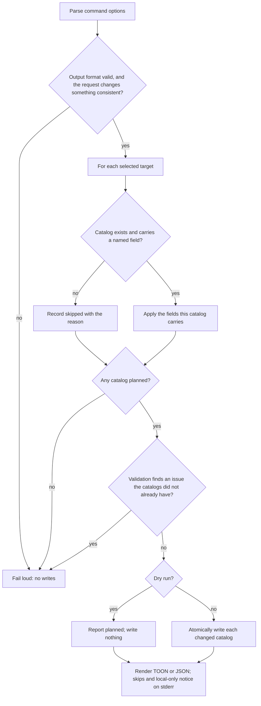

# marketplace set — edit a catalog's own fields in place

## What

`universal-plugin marketplace set` sets or changes the fields a catalog states about itself rather
than about one entry: the marketplaces its plugins may depend on
(`allowCrossMarketplaceDependenciesOn`), its owner, and its description. It changes every selected
catalog that carries the field, together, and keeps everything else.

Before this command, the only CLI route to these fields was `marketplace init --force`, which
regenerates the catalog and loses what a curator wrote by hand. Doctor's repair for a
cross-marketplace dependency named a field no command wrote
([issue #292](https://github.com/cyberuni/universal-plugin/issues/292)). Why this is a command of
its own and not a mode of `update` is [ADR-0023](../../design/decisions/0023-catalog-fields-are-set-by-marketplace-set.md).

The command is a **local edit**. It reads the catalogs under `--root` and writes only those
catalogs. Nothing is fetched.

**Non-goals:** creating a catalog (that is `init` and `add`); renaming a catalog; editing an entry
(that is [`update/`](../update/README.md)); checking that an allowed marketplace exists or lists
anything.

## Use Cases

| Entry point | Trigger | Inputs | Outcome |
|---|---|---|---|
| `marketplace set --allow-dependencies-on <m>` | A listed plugin starts depending on a plugin from marketplace `m`. | One or more marketplace names. | The Claude catalog's allowlist includes each, after the names it already had. |
| `marketplace set --disallow-dependencies-on <m>` | No listed plugin depends on `m` any more. | One or more marketplace names. | Each is taken out of the allowlist. |
| `marketplace set --owner/--owner-email/--owner-url` | The owner's contact details change. | Any of the three. | Each Claude-shaped catalog's owner carries the new value and keeps its other fields. |
| `marketplace set --description <text>` | The catalog's description is missing or stale. | The text. | Each Claude-shaped catalog carries it. |
| `marketplace set --unset <field>` | A field should go. | `description`, `owner.email`, `owner.url`, or `allowCrossMarketplaceDependenciesOn`. | The field is removed. |
| `marketplace set … --dry-run` | A maintainer reviews the change first. | Any change plus `--dry-run`. | The plan is reported and no catalog changes. |
| `marketplace set … --format json` | A script consumes the result. | `--format json`. | stdout is a machine-readable row list; diagnostics stay on stderr. |

### Request decisions

- A request must change something. An empty request fails.
- Each marketplace name must match the catalog name grammar. A name both allowed and disallowed in
  one request fails, and so does a field both set and unset.
- `--unset` takes only the four fields above. `name` and `owner` stay, because every Claude-shaped
  catalog needs both. `--owner` must not be empty.

### Field and target decisions

- With no target flags, all four catalogs are selected.
- Each runtime gets only the fields its catalog carries:

  | Field | Claude | Copilot | Cursor | Codex |
  |---|---|---|---|---|
  | `allowCrossMarketplaceDependenciesOn` | yes | no | no | no |
  | `owner` | yes | yes | yes | no |
  | `description` | yes | yes | yes | no |

  Claude Code is the one runtime that resolves plugin dependencies, so only its catalog carries the
  allowlist. Codex's catalog states no owner and no description. A selected catalog that carries
  none of the fields the request names is reported `skipped`, and so is a selected target with no
  catalog. A request no selected catalog carries fails.
- Allowing a marketplace appends it after the names already listed, once. Disallowing removes it.
  An allowlist left empty is removed, because an empty list says what no list says.
- Owner fields are edited one at a time: `--owner-email` keeps the owner's name and URL.
- A field already present keeps its place. A new top-level field goes before `plugins`, so the
  entries stay last. The entries and every other top-level field are not touched.

### Write and safety decisions

- Every planned catalog is validated before anything is written, with the same checks `marketplace
  validate` runs. A change that introduces an issue, such as an owner email on a catalog with no
  owner name, stops with no write. An issue the catalogs already had does not stop it.
- `--dry-run` writes nothing. Each changed catalog is written atomically.
- Every row carries `target`, `status`, `path`, and `fields`, the fields the request names for that
  catalog, with an optional `reason`. Status is one of `updated`, `unchanged`, `planned`, or
  `skipped`.
- Default output is a compact TOON table on stdout; `--format json` returns the same rows. stderr
  carries each skip and a reminder that no remote marketplace action occurred.

## Control Flow

## Scenario map

| Edge | Path (Given) | Scenario |
|---|---|---|
| allow | a catalog with no allowlist | `allowing a marketplace writes the Claude allowlist only` |
| accumulate | an allowlist with names already | `allowing appends once and disallowing the last name drops the list` |
| owner and description | Claude-shaped catalogs and a Codex catalog | `the owner and description change in each catalog that carries them` |
| unset and convergence | a set owner email; a change already in place | `a field is unset, and an equivalent change is unchanged` |
| bad request | empty, contradictory, or an unknown `--unset` field | `a request that changes nothing or contradicts itself fails` |
| validation gate | an owner email on a catalog with no owner | `a change that would break a catalog writes nothing` |
| no carrier | only the Codex catalog selected, a description | `a request no selected catalog carries fails` |
| dry run | `--dry-run` | `dry run reports the plan without writing it` |
