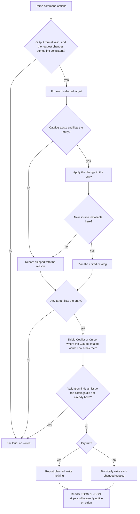

# marketplace update — change one listed entry in place

## What

`universal-plugin marketplace update <name>` changes one entry the repository's catalogs already
list, and keeps every field it is not asked to change. It is how a maintainer moves an entry to a
new source, bumps a pin, or corrects one field without hand-editing a catalog.

[`add/`](../add/README.md) cannot do this safely. `add --force` replaces the entry with what `add`
can derive, so it needs the same inputs `add` needs, and it drops what it cannot derive: a
`category`, an `author`, any field a curator wrote by hand.

The command is a **local edit**. It reads the catalogs under `--root` and writes only those
catalogs. Nothing is fetched.

**Non-goals:** creating a catalog or an entry (that is `add` and `init`); renaming an entry; copying
from another marketplace; editing a catalog's top level; publishing; verifying that a remote source
resolves to a real plugin.

## Use Cases

| Entry point | Trigger | Inputs | Outcome |
|---|---|---|---|
| `marketplace update <name> --source <spec>` | An entry moves to another source, such as from the `github` shorthand to a `url` over https. | A spec read the way `add` reads one. | Each catalog listing the entry states the new source in the form that runtime installs; every other field stays. |
| `marketplace update <name> --ref/--sha` | A pin moves to a newer tag or commit. | A ref, a full sha, or both. | The entry's git source carries the new pin. |
| `marketplace update <name> --<field>` | One field is wrong or stale. | `--description`, `--version`, `--homepage`, `--repository`, `--license`, `--keywords`, or `--category`. | Only that field changes. |
| `marketplace update <name> --unset <field>` | A field, or a pin, should go. | A field name, or `ref` or `sha`. | The field, or the pin, is removed. |
| `marketplace update … --dry-run` | A maintainer reviews the change first. | Any change plus `--dry-run`. | The plan is reported and no catalog changes. |
| `marketplace update … --format json` | A script consumes the result. | `--format json`. | stdout is a machine-readable row list; diagnostics stay on stderr. |

### Request decisions

- The entry is named by the name the catalogs list it under, and must match the catalog name grammar.
- A request must change something: a source, a pin, a field, or an `--unset`. An empty request
  fails rather than reporting every target `unchanged`.
- `--source` is read exactly as `add` reads its spec, and `--path`, `--npm`, `--github`, `--url`,
  and `--subdir` shape it the same way. Without `--source`, those flags fail: they have nothing to
  shape.
- `--source` names where the plugin lives. A `<plugin>@<marketplace>` spec fails and points at
  `add`, which is the command that copies an entry.
- `--unset` cannot remove `name` or `source`; every entry needs both. A field both set and unset in
  one request fails.
- A `--sha` must be the full 40-character hash, checked at input.

### Change decisions

- Every field the request does not name is kept, and so is the entry's key order. The catalog's top
  level and its other entries are not touched.
- A new source is adapted per runtime exactly as `add` adapts one (see
  [`add/`](../add/README.md#source-and-target-decisions)), and stated in that catalog's own shape:
  Codex tags a repository path `local`.
- A new git source keeps the `ref` and `sha` the old one carried, unless the request names a pin of
  its own. Changing how a repository is reached does not change which commit installs.
- A pin with no new source applies to the source each catalog already states. An entry whose source
  is not git fails naming the catalog and the source kind.
- `--unset ref` and `--unset sha` remove a pin from the source. `--ref` alone keeps an existing
  `sha`, which may then name a commit the new ref does not; `--unset sha` drops it in the same run.
- A Codex entry takes only the field flags its catalog carries, `version` and `category`. The others
  are not written there.

### Target decisions

- With no target flags, all four catalogs are selected.
- A selected catalog that does not exist, or that does not list the entry, is reported `skipped`
  with the reason. An entry listed in no selected catalog fails and points at `add`.
- A new source a runtime cannot install is reported `skipped` for that runtime, and its catalog
  keeps the entry as it was. Removing the entry would be a deletion nobody asked for.
- **Shielding.** When Copilot CLI or Cursor has no catalog of its own, it reads the Claude one. If the
  update gives the entry a source there that the runtime cannot install, its own catalog is written,
  derived from the Claude one without the entries it cannot install, the same shield `add` writes.

### Write and safety decisions

- Every planned catalog is validated before anything is written, with the same checks `marketplace
  validate` runs, including that a `./` source exists. An update that would introduce an issue stops
  with no write. An issue the catalogs already had does not stop it; reporting that is `validate`'s
  job.
- `--dry-run` writes nothing. Each changed catalog is written atomically.
- Every row carries `target`, `status`, `entry`, `source`, and `path`, with an optional `reason`.
  Status is one of `updated`, `unchanged`, `planned`, or `skipped`.
- Default output is a compact TOON table on stdout; `--format json` returns the same rows. stderr
  carries each skip and a reminder that no remote marketplace action occurred.

## Control Flow

## Scenario map

### `marketplace update` — the request

| Edge | Path (Given) | Scenario |
|---|---|---|
| empty request | no change flag | `a request that changes nothing fails` |
| protected field | `--unset name` or `--unset source` | `name and source cannot be unset` |
| contradiction | a field both set and unset | `a field both set and unset fails` |
| marketplace spec | `--source <plugin>@<marketplace>` | `a marketplace spec is not a source` |
| unknown entry | no selected catalog lists it | `an entry no catalog lists points at add` |

### `marketplace update` — the change

| Edge | Path (Given) | Scenario |
|---|---|---|
| source switch | a `github` entry with curated fields | `a new source keeps every other field` |
| pin carry | a pinned git entry, a new git source, no pin flags | `a new git source keeps the old pin` |
| pin bump | a pinned git entry, `--ref` and `--unset sha` | `a ref moves and the stale sha goes` |
| pin misuse | a pin on an npm entry | `a pin on an entry with no git source fails` |
| one field | a field flag | `one field changes and the rest stay` |
| codex shape | a description and a category | `a Codex entry takes only the fields its catalog carries` |

### `marketplace update` — targets, writes, and rendering

| Edge | Path (Given) | Scenario |
|---|---|---|
| not listed | a catalog without the entry | `a catalog that does not list the entry is skipped` |
| unsupported source | a new source a runtime cannot install | `a runtime that cannot install the new source keeps the old entry` |
| shielded | Copilot without a catalog, a new npm source | `a runtime reading the Claude catalog is shielded` |
| convergence | the entry already says this | `an equivalent update is unchanged` |
| validation gate | a new `./` source that does not exist | `an update that would break a catalog writes nothing` |
| prior issue | a catalog with an unrelated issue | `an issue the catalog already had does not block the update` |
| dry run | `--dry-run` | `dry run reports the plan without writing it` |
| default rendering | a successful invocation | `default output is TOON and states the local-only boundary` |
| JSON rendering | `--format json` | `JSON output exposes the result rows` |
