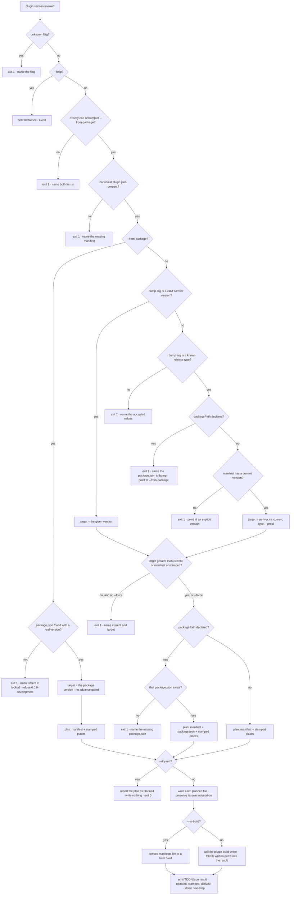

# plugin version — move the plugin's version, and keep every version-carrying file in sync

## What

`universal-plugin plugin version` **stamps** a plugin's version. In one call it writes the
**authored** numbers (the canonical manifest and, for an explicit version, the npm `package.json`
beside it), every **stamped place** that restates the version (the skills' `npx`/`upx` pins, the
`.plugin/pins.json` map, the marked `mcpServers` entries), and then **re-derives** the vendor
manifests through `plugin build`'s own writer, so nothing that carries a version is left behind.
Every command follows the AXI output contract ([../../axi/](../../axi/README.md)).

The seam is **derive versus stamp** ([ADR-0010](../../design/decisions/0010-version-policy.md)):
[`plugin build`](../build/README.md) derives files from source and never decides a version; this
verb decides the version and writes it into the places that restate it.

**Key terms**

- **Authored version** — a version a human (or a release tool) writes by hand. There are exactly two:
  the canonical `plugin.json` `version` field, which is the plugin's source of truth (ADR-0007), and
  the `version` in the `package.json` at the project's declared `packagePath`, which is npm's own
  number. Nothing else on disk is authored.
- **Derived version** — a version some command copies out of an authored one. The per-vendor
  manifests (`plugin build`) and the repository-local marketplace catalogs (`marketplace init`) are
  derived. `build` copies whatever `plugin.json` carries and never decides it.
- **Stamped place** — a file that restates the version in the source tree and so is written by this
  verb, not by `build`: the `npx`/`upx <cli>@<version>` pins in every text file under the skills
  directory (Markdown, `json`/`yaml`/`txt`, and scripts `.js .mjs .cjs .ts .mts .cts .sh .py`),
  `.plugin/pins.json`, and each authored `mcpServers` entry marked `pinToPluginVersion`. The compiled
  script's embedded version (#177) is a future stamped place; the stamping pass is the hook point for
  it.
- **`packagePath`** — the CLI's own config key in `.agents/universal-plugin.json` (beside the
  canonical `plugin.json`), naming the directory holding the npm package that ships this plugin, as a
  path relative to the plugin root (`--root`, else cwd). It is not read from the manifest's extensions
  namespace (ADR-0007, amended for issue #79). `config get --key packagePath` reports it through the
  same reader. Read by `plugin version --from-package`.
  Absent when the plugin is not published to npm.
- **Version source** — exactly one of three. A semver **release type** (`major`, `minor`, `patch`,
  `premajor`, `preminor`, `prepatch`, `prerelease`) is applied to the current version. An **explicit
  version** (`1.4.0`) is used as given; semantic-release calls it as
  `plugin version ${nextRelease.version}`. `--from-package` reads the version a package manager
  already decided from `<packagePath>/package.json`, or the plugin root's `package.json` when no
  `packagePath` is declared; changesets and release-please call it as
  `changeset version && plugin version --from-package`. Passing a bump and `--from-package`, or
  neither, is an error.

**Why the verb does not write the derived files.** A version bump touching
`.claude-plugin/plugin.json` directly would be a second writer for a file `plugin build` already
owns, with its own idea of the derivation rules — the two would drift on the first change to either.
So this node re-derives by **calling `build`**, not by re-implementing it. `--no-build` opts out for
callers that drive `build` themselves.

**Why the two authored numbers move together.** They are the same release. A bump that moved only
the manifest would leave the npm tarball claiming a version the plugin inside it does not have.
With a release type or an explicit version this verb writes both. With `--from-package` the package
manager already moved the `package.json`, so the verb only reads it and never rewrites it.

**Why a release type is refused where `packagePath` is declared.** A declared `packagePath` means a
package manager owns the number. Computing a second one here would race it. The error names the
`package.json` to bump and points at `--from-package`. An explicit version stays allowed (it is how
semantic-release hands the number over) and also writes the `packagePath` `package.json`.

**Why `--from-package` has no advance guard.** It carries a number someone else decided, and a
release script may run twice. Re-stamping the version the manifest already carries is fine. It
refuses a package holding `0.0.0-development` (the semantic-release placeholder, which is not a
release) and a package with no version, and names the explicit form as the alternative. An explicit
version replaces a manifest still at `0.0.0-development` without `--force`.

**Why a write keeps the file's own format.** Each authored file is rewritten the way it was already
formatted (issue #164): its indentation, its line ending and whether it ends in a newline, and the
original text of every value the bump leaves unchanged — so an array a formatter collapsed onto one
line stays on that line, and a release does not fail the repository's formatter check. Only a value
that changed is laid out fresh, one entry per line. A file with no indentation to read takes the one
`.editorconfig` sets for it, then a tab. `publish sync-version` writes through the same applier, so
the same holds there. This covers the pins map too: `.plugin/pins.json` is a key-sorted map, written
only when it is non-empty or already exists, in the repository's own JSON format.

**Non-goals** — version **policy**: which number is authoritative for a repo, whether a marketplace
source should resolve a tag rather than a branch, and what is done about content that changed without
a bump. All three are settled in
[ADR-0010](../../design/decisions/0010-version-policy.md), which leaves this verb's behavior
unchanged and puts the drift check in `doctor`. Also out of scope: deriving the vendor manifests
(`plugin build`); publishing to npm or to a marketplace
(`cyberplace`).

## Relationship to `npm version`, changesets, and the other release tools

- **`npm version`** knows only `package.json`. Run against a plugin it moves the number that is *not*
  the source of truth and leaves the canonical manifest, and every derived artifact, stale. It is
  not a substitute for this verb.
- **changesets** and **release-please** own package versions, and repos that use them (including
  this one) want the number decided there. They run `plugin version --from-package` right after the
  tool moves `package.json`.
- **semantic-release** has no version until release time, so the package holds `0.0.0-development`
  and `prepareCmd` runs `plugin version ${nextRelease.version}`.
- A repo with no release tool runs `plugin version <bump>`: it is the whole release-number step.

The three sources differ **only in where the number comes from**. They share **one stamping pass**:
the code that writes a resolved version into the authored files and the stamped places is the same,
so they cannot drift. All then re-derive the vendor manifests through the same `build` writer, so
none leaves them carrying the old number (#143). `--no-build` skips that step for a release script
that runs `build` itself; it never skips a stamp.

### The stamped places

One call writes all of these, and a failing guard writes none.

- **`plugin.json`**, and the `packagePath` `package.json` (explicit version and release type only).
- **Skill pins.** Every `npx`/`upx <pkg>@<version>` under the skills directory, in any text file
  listed under *Stamped place* above. The plugin's own package (named by the `package.json` above)
  moves to the new version, other pnpm-workspace member CLIs move to their workspace `package.json`
  versions, and external packages are untouched. A skill marked `metadata.pin-exempt: true` is
  excluded entirely.
- **`.plugin/pins.json`**, the key-sorted map of own and workspace pins.
- **Marked `mcpServers` entries.** Each authored entry with `pinToPluginVersion: true` is stamped in
  place: inline in `plugin.json` under `extensions["org.cyberuni.universal-plugin"].mcpServers`, or
  in the declared mcp file(s), or the spec-fixed `./mcp.json`. The marker stays so the next stamp
  finds the entry. A marked entry whose command is not `npx`/`upx`, or whose args carry no package
  specifier, produces a warning and is left unstamped; it does not fail the run. `build` then
  copies the entry as authored and strips the marker (see [`plugin/build/`](../build/README.md)).

### Deprecated aliases

- `publish sync-version` runs `plugin version --from-package` and prints the same output, with the
  stderr warning `warn: publish sync-version is deprecated and will be removed in the next minor
  release — use plugin version --from-package`.
- [`plugin bundle`](../bundle/README.md) keeps its own behavior and warns that `plugin version`
  stamps the skill pins now.

## Checking that every file agrees — `publish check-version`

A release tool moves one number; the other places follow only when something carries it. A
changesets Version Packages PR that bumps `package.json` and never runs `plugin version` leaves
`plugin.json`, the vendor manifests, the catalogs and the skill pins on the previous version, and
nothing fails until a consumer installs the wrong one (issue #164). `release-please` and
`semantic-release` move the number the same way, and `init --npm` wires the stamp only into a
changesets `version` script.

`universal-plugin publish check-version` is the read-only gate for that case. It writes nothing and
exits 1 when any file disagrees, so a repository runs it in CI or in its `verify` script and the
missed sync fails the release PR rather than the published package.

- **The reference** is the number the release decides: the `package.json` when it holds a real
  version, else the canonical `plugin.json`. If neither holds a real version, nothing drifts. A declared `packagePath` with no `package.json` fails,
  as it does for `plugin version`.
- **Compared against it:** the canonical `plugin.json` (a manifest with no `version` under a
  versioned package drifts); each declared vendor's derived manifest that exists and carries a
  `version`; this plugin's entry in each catalog the repository carries; and every skill file under
  the manifest's skills path pinning the package (`npx`/`upx <package>@<version>`, either `-y` or
  `--yes`); and each `mcpServers` entry marked `pinToPluginVersion` (kind `mcp-pin`). Pins are read
  with the stamper's reader and skip what it skips: a pin-exempt skill, and a pin that is not a
  version (`<version>`, `latest`, a range). A compiled skill script
  ([ADR-0019](../../design/decisions/0019-build-compiles-skill-scripts.md)) is compared by the version
  its header embeds (kind `compiled-script`), and only by that: a pin its inlined code carries is not
  a second surface, and a script whose source moved on is `plugin build`'s `stale` report, not drift.
  One file is never reported twice.
- **Unstamped, not drifted.** A place holding `0.0.0-development` is reported in a separate
  `unstamped` list and never as drift: a semantic-release repo commits the placeholder, and the
  release stamps it. `check-version` prints `<path> is unstamped (0.0.0-development) — the release
  stamps it` to stderr for each, and the summary reads `checked N, drifted N, unstamped N`.
- **Not compared:** what does not exist. An undeclared vendor, a catalog the repository does not
  carry, and pins with no `packagePath` (there is no package to pin) are absent, not drifted.
- **The result** names every file that disagrees, by path relative to the plugin root, with the
  version it carries. The next step names the command that repairs it:
  - package and manifest disagree: `/universal-plugin:version`, the skill that decides which number
    is right;
  - the package is the source: `→ universal-plugin plugin version --from-package`;
  - the manifest is the source and only vendor manifests or catalogs drift:
    `→ universal-plugin plugin build`;
  - otherwise `→ universal-plugin plugin version <expected> --force`.

`doctor` asks this command rather than re-reading the files, and reports each disagreeing file as
its own `version-drift` finding. `doctor` stays advisory and exits 0; `check-version` is the one that
fails.

## The skill question

A verb in this package is asked two separate questions about a companion skill, and they have
different answers here. **Judgment: none to encode. Reach: needed, and shipped as a route on the
existing gateway skill rather than a new one.**

**Judgment — nothing to encode.** ADR-0005 §3's bar is that an interactive front-end ships as a
skill because the CLI is non-interactive by construction. This verb has no interactive step: once
the version source is named, the new version, the set of files to write, and the re-derivation are
all determined by `semver.inc`, the package's own number and the existing `build` writer, and the
guards reject every ambiguous input rather than guessing at one. The one genuinely judged step — *which* release type a change
deserves — is deliberately not this verb's. It is a changelog-authoring decision, the ecosystem
answer for it (changesets) is already in this repo, and it already composes with the verb through
`plugin version --from-package`.

**Reach — not covered before this node, and judgment is the wrong axis to settle it on.** A verb
nobody can find ships unreachable however little judgment it needs. Measured:

- `plugin init --npm` wires `package.json` `files` and nothing else — it adds no dependency, no
  script, and no pin, so a scaffolded plugin repo does **not** have this CLI installed.
- The package is published, so the verb is reachable with no install as
  `npx universal-plugin plugin version <bump>` — that is the same unpinned invocation the gateway
  skill used for `governance show` before ADR-0017 retired it.
- The skill surface is this package's discoverability surface for exactly this class of ask, and it
  covered create / adopt / inspect / update / delete. **None of them is "move the version"**, and the
  update route is scoped to what a plugin *declares* — vendors and components — not to what it
  releases under. An agent asked to bump a plugin's version would have found no route and hand-edited
  a `version` field, which is precisely the drift this verb exists to prevent.

So the reach surface is required, and it is **`skills/version/`** — a skill of its own.

This reverses what this section first recorded. The original answer was a route on a single gateway
skill, on the reasoning that a second top-level skill would compete for the same triggers. That
reasoning held while every route shared one object: the manifest's declaration. This verb does not
share it — it moves the number the plugin *releases under*, which is why the update route could not
absorb it in the first place. Skills scoped by object do not compete;
[ADR-0009](../../design/decisions/0009-split-the-plugin-gateway-skill.md) records the split and the rule
that replaced the gateway.

Recorded so a later reader does not re-open either half: the standalone skill is now the decision, and
the reach it carries is its own.

## Use Cases

The entry points, each a mode of the `universal-plugin plugin version` verb, given as
**trigger / inputs / outcome**:

- **Bump by release type** — `plugin version <major|minor|patch|premajor|preminor|prepatch|prerelease>
  [--preid <id>] [--no-build] [--dry-run]`.
  - *trigger:* an author is cutting a release and knows its class.
  - *inputs:* the release type; the canonical manifest's current `version`; the project root
    (`--root`, else cwd); `packagePath` from `.agents/universal-plugin.json` when present.
  - *outcome:* the canonical `plugin.json` and — when `packagePath` is declared — that
    `package.json` both carry the incremented version, and so do the stamped places; the vendor
    manifests are re-derived through `plugin build` unless `--no-build`; each written file is
    reported. Where `packagePath` is declared the release type is refused (see above).
- **Stamp from the package** — `plugin version --from-package [--no-build] [--dry-run]`.
  - *trigger:* changesets or release-please just moved `package.json`.
  - *inputs:* `<packagePath>/package.json`, or the plugin root's `package.json` when no
    `packagePath` is declared.
  - *outcome:* every authored and stamped place carries the package's version; the package is not
    rewritten; re-stamping the same version succeeds.
- **Set an explicit version** — `plugin version <x.y.z> [--force] [--no-build] [--dry-run]`.
  - *trigger:* an author knows the exact number (a first release, a coordinated version, a correction).
  - *inputs:* the version literal; the same root and config as above.
  - *outcome:* the same writes, with the version used as given. A manifest carrying no `version` yet
    is seeded this way, and so is one at `0.0.0-development`; a version that does not advance on the
    current one is refused without `--force`. Used by semantic-release's `prepareCmd`.
- **Print the command reference** — `plugin version --help`.
  - *trigger:* an author asks what the verb does.
  - *inputs:* none.
  - *outcome:* a synopsis, the flags, the accepted release types, and one example on stdout; exit 0.

## Control Flow

All four use cases enter one graph. Every guard resolves **before** the first write, so a failing
run leaves the tree untouched. Decisions are nodes, branches are edges.

A run never prompts — the "prompt?" decision is barred to "no" on every path (AXI, ADR-0003).

## Scenario map

Grouped by concern; 1:1 with [`version.feature`](./version.feature).
`| Edge | Path (Given) | Scenario |`.

### Move the authored version

| Edge | Path (Given) | Scenario |
|---|---|---|
| inc patch | manifest at `1.2.3`, `patch` | `a patch bump moves the canonical manifest version` |
| inc minor | manifest at `1.2.3`, `minor` | `a minor bump zeroes the patch component` |
| inc major | manifest at `1.2.3`, `major` | `a major bump zeroes the minor and patch components` |
| exact | manifest at `1.2.3`, `2.0.0-rc.1` | `an explicit version is used exactly as given` |
| preid | manifest at `1.2.3`, `prerelease --preid beta` | `--preid names the prerelease identifier` |
| prerelease increment | manifest at `1.2.4-beta.0`, `prerelease` | `a prerelease bump increments the existing identifier` |
| seed | manifest with no `version`, explicit `0.1.0` | `an explicit version seeds a manifest that has none` |
| preserve fields | manifest with `name` and `description` | `every other manifest field is preserved` |
| preserve indent | manifest indented with two spaces | `the canonical manifest keeps its own indentation` |
| preserve lines | tab-indented manifest, one-line array, trailing newline | `the canonical manifest keeps the lines the bump does not change` |
| editorconfig | single-line manifest, `.editorconfig` sets 4 spaces | `a manifest with no indentation to read takes the .editorconfig indentation` |

### Pick the version source

| Edge | Path (Given) | Scenario |
|---|---|---|
| from package | `packagePath` declared, package at `1.3.0` | `--from-package stamps the version the package already carries` |
| no rewrite | same | `--from-package leaves the package.json untouched` |
| no advance guard | manifest already at `1.3.0` | `--from-package re-stamps the version the manifest already carries` |
| root package | no `packagePath`, root package at `2.0.0` | `--from-package reads the plugin root package.json when no packagePath is declared` |
| guard: no package | neither found | `--from-package names where it looked when there is no package` |
| guard: no version | package without `version` | `--from-package refuses a package without a version` |
| guard: placeholder | package at `0.0.0-development` | `--from-package refuses the semantic-release placeholder` |
| guard: both | `1.4.0 --from-package` | `a version and --from-package together are refused` |
| guard: neither | no argument | `neither a version nor --from-package is refused` |
| guard: release type | `packagePath` declared, `minor` | `a release type is refused where packagePath is declared` |
| explicit allowed | `packagePath` declared, `1.4.0` | `an explicit version is still taken where packagePath is declared` |
| unstamped manifest | manifest at `0.0.0-development`, `1.0.0` | `an explicit version replaces an unstamped manifest without --force` |

### Stamp the places that restate the version

| Edge | Path (Given) | Scenario |
|---|---|---|
| markdown and scripts | pins in `SKILL.md` and `scripts/run.mjs` | `skill pins are stamped in Markdown and in scripts` |
| other text | pins in `json`/`yaml`/`txt` | `skill pins are stamped in json, yaml and txt files` |
| workspace | a workspace CLI and an external one | `a workspace CLI pins to its workspace version and an external package is untouched` |
| pin-exempt | `metadata.pin-exempt: true` | `a pin-exempt skill is excluded entirely` |
| pins map | own and workspace pins | `.plugin/pins.json maps the pins, key-sorted` |
| no pins | nothing pinned, no map yet | `no pins map is written when there is nothing to map` |
| existing map | map exists, now empty | `an existing pins map is kept current` |
| map format | `.editorconfig` sets 2 spaces | `the pins map takes the repository's JSON format` |
| inline mcp | marked entry in `plugin.json` | `a marked inline mcpServers entry is stamped and keeps its marker` |
| mcp file | marked entry in `./mcp.json` | `a marked entry in an authored mcp file is stamped and keeps its marker` |
| mcp untouched | file with nothing to move | `an mcp file with nothing to move is left unwritten` |
| mcp warn | marked entry, command not a runner | `a marked entry that cannot be stamped warns and does not fail` |
| dry run | `--dry-run` | `--dry-run plans every stamped place and writes none` |

### Keep the npm package.json in lockstep

| Edge | Path (Given) | Scenario |
|---|---|---|
| write package.json | `packagePath` declared, package.json present | `the packagePath package.json moves to the same version` |
| preserve package fields | that package.json has `name` and `scripts` | `the package.json keeps its other fields and its own indentation` |
| no packagePath | no `.agents/universal-plugin.json` | `without a declared packagePath only the manifest is written` |
| report both | `packagePath` declared | `both authored files are reported as updated` |

### Re-derive the vendor manifests

| Edge | Path (Given) | Scenario |
|---|---|---|
| derive | manifest declaring a `claude-code` harness | `the derived vendor manifest carries the new version` |
| opt out | same, `--no-build` | `--no-build leaves the derived manifests untouched` |
| nothing to derive | manifest declaring no harnesses | `a plugin with no declared harnesses still bumps` |

### Guards

| Edge | Path (Given) | Scenario |
|---|---|---|
| guard: no manifest | empty root | `a missing canonical manifest fails loud` |
| guard: no current | manifest with no `version`, `patch` | `a release type with no current version points at an explicit version` |
| guard: bad arg | `frobnicate` | `an unrecognized bump argument names the accepted values` |
| guard: not greater | manifest at `1.2.3`, explicit `1.0.0` | `a version that does not advance is refused` |
| force downgrade | manifest at `1.2.3`, explicit `1.0.0`, `--force` | `--force allows a version that does not advance` |
| guard: missing package.json | `packagePath` declared, no package.json there | `a declared packagePath with no package.json fails before any write` |
| guard: writes nothing | any failing guard | `a failing guard leaves every file untouched` |
| dry run | `--dry-run` | `--dry-run reports the plan and writes nothing` |
| guard: unknown flag | `--frobnicate` | `an unknown flag fails loud` |

### AXI output contract

| Edge | Path (Given) | Scenario |
|---|---|---|
| TOON result | success, no `--format` | `a successful run prints a row per written file plus the updated aggregate` |
| row actions | stamped and derived files | `rows say updated, stamped or derived and the summary counts each` |
| JSON result | `--format json` | `--format json returns the from, to, and written fields` |
| next-step | success | `a successful run ends with a next-step line` |
| next-step, no build | `--no-build` | `--no-build points at plugin build` |

### Check that every file agrees

| Edge | Path (Given) | Scenario |
|---|---|---|
| agree | every file at the package version | `check-version passes when every file carries the same version` |
| package reference | `packagePath` declared, every other file behind | `check-version names every file a release left behind` |
| manifest reference | no `packagePath`, a vendor manifest behind | `without packagePath the canonical manifest is the reference` |
| pin only | only a skill pin behind | `a skill pin left behind points at plugin version` |
| mcp pin | a marked entry behind | `a marked mcpServers entry left behind is drift` |
| unstamped | package at `0.0.0-development` | `a place at 0.0.0-development is unstamped, not drifted` |
| nothing real | no real version anywhere | `nothing drifts when no file holds a real version` |
| manifest only | manifest source, vendor behind | `a vendor manifest left behind points at plugin build` |
| disagree | package and manifest differ | `a package and manifest that disagree point at the version skill` |
| not a version | pins `<version>` and `latest` | `a pin that is not a version is not compared` |
| compiled script | a compiled script's embedded version behind | `a compiled script behind on its version is drift, reported once` |
| guard: no manifest | empty root | `check-version fails loud without a canonical manifest` |

### Deprecated aliases

| Edge | Path (Given) | Scenario |
|---|---|---|
| sync-version | `publish sync-version` | `publish sync-version warns and runs the --from-package stamp` |

### Print the command reference

| Edge | Path (Given) | Scenario |
|---|---|---|
| help | `--help` | `--help prints a concise reference` |

## References

- Agent Plugins Specification v1.0.0 (`agent-plugins.org`) — backs the canonical root `plugin.json`
  as the plugin's version source of truth. Adoption recorded in ADR-0007.
- ADR-0006 (this project) — the shared-object charter test this node passes: its object **is** the
  canonical manifest.
- ADR-0005 §3 (this project) — the bar the skill question above is answered against.
- [ADR-0010](../../design/decisions/0010-version-policy.md) — the derive/stamp seam this node
  implements.
- [`plugin/build/`](../build/README.md) — the writer this node calls to re-derive; the reason the
  derived manifests are not written here.
